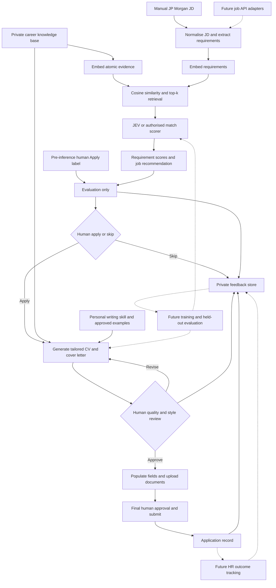

# Personal AI Engineering — Roadmap

**Last updated:** 27 November 2026  
**Sprint:** Friday, 27 November 2026 — first vertical slice  
**Milestone:** Saturday, 28 November 2026  
**Current focus:** `find-my-next-job` — V0.1

## Objective

Build a personalised, feedback-driven AI system that automates the job application lifecycle: ingest a JD, assess career fit, decide whether to apply, tailor a CV and cover letter, assist with submission, and learn from human feedback and recruitment outcomes.

Build one real end-to-end vertical slice before scaling to multiple job sources.

## Completed

### Personal Portfolio — V1
- [x] Build and deploy personal portfolio to Vercel

### Career Knowledge Base — V0.1
Repository: [career-knowledge-base](https://github.com/pjtina39/career-knowledge-base) (private).
- [x] Define experience, project, skill and evidence schemas
- [x] Ingest 4 roles, 21 atomic evidence records and 26 skills
- [x] Implement source traceability and verification status
- [x] Implement privacy and sensitivity controls
- [x] Pass schema, integrity, traceability and privacy validation
- [x] Pass 7 automated tests
- [x] Configure GitHub Actions
- [x] Document results and limitations

Status is based on the repository README supplied by the owner. Freeze the knowledge base for this sprint; do not duplicate or redesign it.

## V0.1 — First vertical slice: JP Morgan

**Input:** One manually supplied JP Morgan Applied AI & ML — Senior Associate JD and the existing private career knowledge base.

**Ground truth:** Human application decision = Apply (positive label, established before inference). This is a personal application preference, not proof of qualification fit or hiring success.

**Output:** Evidence-grounded match assessment, reviewed CV and cover letter, approved application submission (manual fallback if necessary), and persistent feedback records.

## Friday, 27 November — P0: complete the first slice today

Timeboxes are suggested from 14:00; prioritise a working local pipeline and real application over UI or deployment.

### 1. Setup and ingest (14:00–14:40)
- [x] Establish human decision for JP Morgan: Apply
- [ ] Create or open `find-my-next-job` and connect existing private KB
- [ ] Confirm exact JD, vacancy status and referral route
- [ ] Persist original JD, job ID, source and pre-inference human label; keep label out of inference context
- [ ] Extract required/preferred skills, experience, achievements expected, responsibilities and mandatory requirements into a standard job schema

### 2. Retrieval, matching and decision (14:40–16:10)
- [ ] Embed atomic evidence records and job requirements using the same embedding model
- [ ] Compute cosine similarity and retrieve top-k evidence per requirement, retaining evidence IDs and scores
- [ ] Define replaceable MatchScorer interface; use JEV only if authorised and available, otherwise use an independent baseline and label it accurately
- [ ] Score requirement/evidence support using JEV probability (or baseline score); distinguish unsupported evidence from proven absence of a skill
- [ ] Aggregate requirement scores with explicit weights and mandatory requirement checks; do not treat cosine or aggregate score as hiring probability
- [ ] Save retrieval results, scorer outputs, model/prompt versions, strengths, gaps and independent apply/skip recommendation
- [ ] Compare recommendation with human Apply label; record fit rating, preference, corrections and final apply/skip decision
- [ ] Generate documents only after human decision to apply

### 3. Personal writing skill and application generation (16:10–17:30)
- [ ] Create `skills/personal-writing/SKILL.md` with concise, plain English, evidence-grounded claims, achievement-focused bullets and natural professional tone
- [ ] Add separate CV and cover letter style rules and private approved writing examples
- [ ] Generate tailored CV and cover letter using JD, retrieved evidence and versioned writing skill
- [ ] Validate claims and metrics against source evidence; check sensitivity before external use
- [ ] Save original outputs and evidence references
- [ ] Review each document separately for factual accuracy, relevance, evidence selection, writing style and overall quality (1–5)
- [ ] Save ratings, comments, edits, approved versions and explicit preference pairs where appropriate
- [ ] Approve final documents only after factual errors are resolved

### 4. Application automation (17:30–19:00)
- [ ] Inspect JP Morgan application form and permitted automation options
- [ ] Map known career data to fields; request missing information instead of guessing
- [ ] Populate fields and upload approved documents where supported
- [ ] Pause for final human review and explicit submission approval
- [ ] Submit application or use manual fallback for login, CAPTCHA, referral or platform restrictions
- [ ] Save confirmed submission status, application ID, document versions and timestamp; initialise recruitment outcome as pending

### 5. Feedback persistence and smoke test (19:00–19:30)
- [ ] Persist separate job decision, CV quality, cover letter quality and application outcome records
- [ ] Link records by job/application/generation IDs; store KB, embedding, scorer, prompt and writing skill versions
- [ ] Test one end-to-end run and confirm feedback survives restart
- [ ] Commit code without private data or secrets; document actual results and blockers

### Definition of done today
- [ ] JP Morgan JD ingested and relevant evidence retrieved using embeddings and cosine similarity
- [ ] Independent match scoring completed with JEV or explicitly identified fallback; human decision recorded
- [ ] Tailored CV and cover letter reviewed for accuracy and personal writing style; feedback and approved versions saved
- [ ] Application populated and submitted with explicit approval, or external blocker documented and manual fallback used
- [ ] First labelled case and document feedback available for future training

### P1 — only after the first slice works
- [ ] Minimal protected UI, deployment and smoke test if time permits
- [ ] Prepare privacy-safe demo and two-minute Accenture walkthrough
- [ ] Add sanitised portfolio summary if useful; no private data in public deployment

## Learning and automation design

Initially use human decision gates and a versioned writing skill. Ratings do not update model weights automatically. Collect positive and negative job labels, separate qualification and preference scores, document ratings and approved edits. Keep held-out jobs separate from training and assess agreement, false apply/skip decisions, factual grounding, style quality and editing effort. One positive sample is not enough to train or validate a classifier.

As sufficient representative data accumulates, train and validate personalised matching/ranking models and optimise generation through approved examples, prompt refinement or preference learning. Reduce routine human review only when held-out results and safety checks justify it; retain review for uncertain cases, factual issues and final submission approval. Connect permitted job website APIs via adapters for discovery and use supported application interfaces; discovery APIs do not necessarily support submission.

## Future backlog — Find My Next Job

### V0.2 — Scale job discovery and automation
- [ ] Integrate permitted job APIs through independent adapters
- [ ] Support multiple sources, scheduled ingestion and deduplication
- [ ] Implement batch matching and personalised ranking
- [ ] Extend application assistance to supported platforms

### V0.3 — Personalised learning
- [ ] Collect positive and negative human apply labels and separate fit/preference ratings
- [ ] Collect CV and cover letter quality ratings and preference pairs
- [ ] Establish independent held-out evaluation data; avoid job/version leakage
- [ ] Train supervised matching classifier and ranking model when sufficient labels exist
- [ ] Compare with LLM baseline
- [ ] Use feedback retrieval and prompt optimisation; experiment with preference learning when data permits
- [ ] Validate improvements before deployment

### V0.4 — Recruitment outcome tracking
- [ ] Integrate authorised email API and classify recruitment messages
- [ ] Link messages to application records
- [ ] Distinguish automatic acknowledgements from positive HR responses
- [ ] Track screening, interviews, rejections and offers
- [ ] Measure positive HR response rate as primary early outcome metric
- [ ] Measure interview and offer conversion rates using defined observation windows
- [ ] Treat pending applications as unresolved, not failures

### V0.5 — Closed-loop optimisation
- [ ] Analyse relationships between matching, document quality and recruitment outcomes
- [ ] Define reward signals; account for noisy, delayed outcomes and external hiring factors
- [ ] Explore reward modelling, outcome-driven ranking and contextual bandits if data supports them
- [ ] Validate and version model updates; monitor performance

## Success metrics

- Human-model agreement on apply decisions (one sample is a case result, not overall accuracy)
- Qualification-fit and preference rating agreement
- CV and cover letter quality ratings, factual grounding and human editing effort
- Time saved per application
- Positive HR response rate, interview conversion rate and offer conversion rate

## Future backlog — Career Knowledge Base
- [ ] Model education, certifications and languages
- [ ] Ingest additional verified public projects
- [ ] Implement approved public export
- [ ] Automate CV extraction and evidence deduplication
- [ ] Resolve unsupported portfolio metric
- [ ] Improve source verification

## Independent learning and research — no sprint deadline

Separate from `find-my-next-job`. No Vercel deployment or public portfolio integration required.

### Personal Intelligence Agent
- [ ] Define learning interests and connect permitted information sources
- [ ] Implement relevance classification, ranking and personalised digest
- [ ] Collect feedback and explore recommendation models

### LLM Evaluation
- [ ] Build reusable evaluation framework on public or synthetic data
- [ ] Compare models and prompts; study calibration, consistency and uncertainty
- [ ] Explore paired bootstrap confidence intervals and agent evaluation
- [ ] Document reproducible experiments

### Retrieval Lab
- [ ] Compare chunking, embeddings, lexical/semantic and hybrid retrieval
- [ ] Explore reranking and evaluate relevance, latency and cost

### AI Engineering Skills
- [ ] Develop system design, APIs, databases, Docker, CI/CD, model serving and observability skills

## Development principles

- One real vertical slice before scaling; timebox optional complexity.
- Human ground truth before inference; keep labels separate from model inputs.
- Collect feedback from the first interaction; ratings do not automatically train a model.
- Ground every claim in evidence; preserve privacy and never invent qualifications.
- Never submit without explicit human approval; respect platform restrictions.
- Evaluate before updating models; distinguish implemented, tested and planned features.
